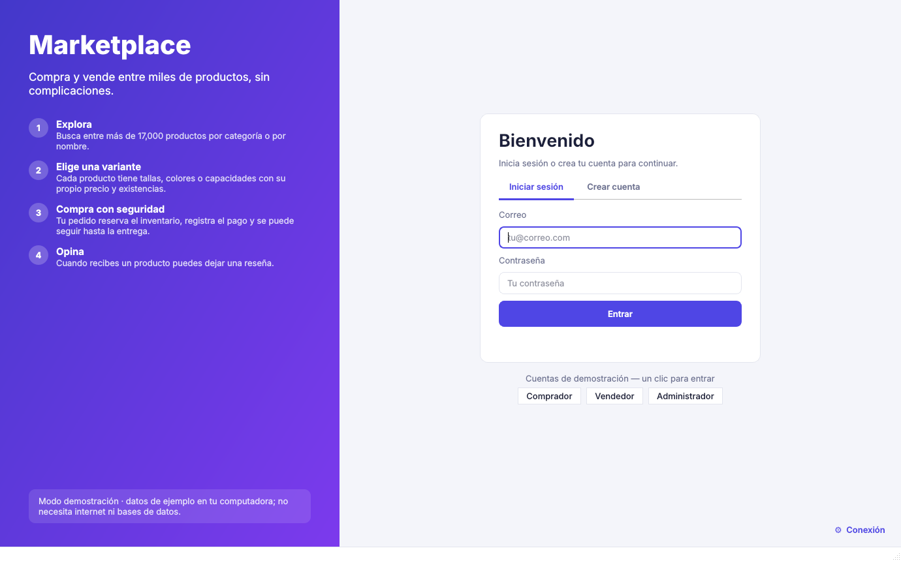
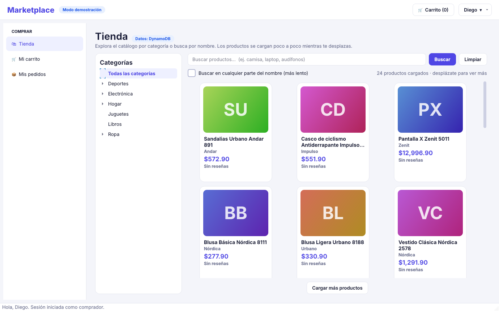
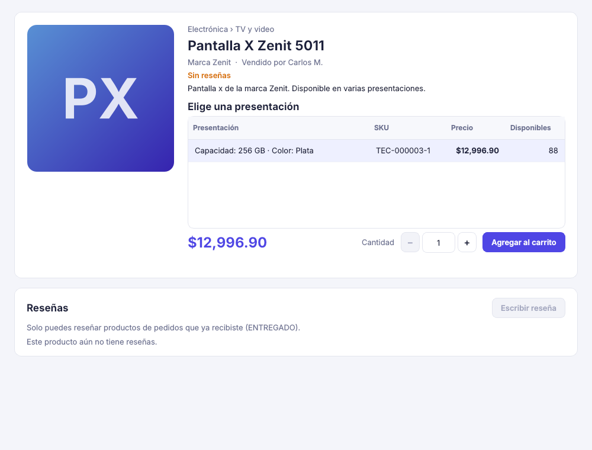
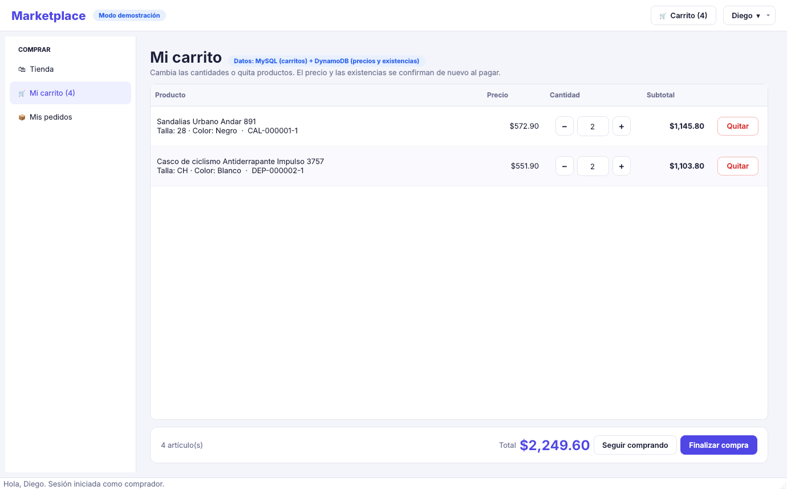
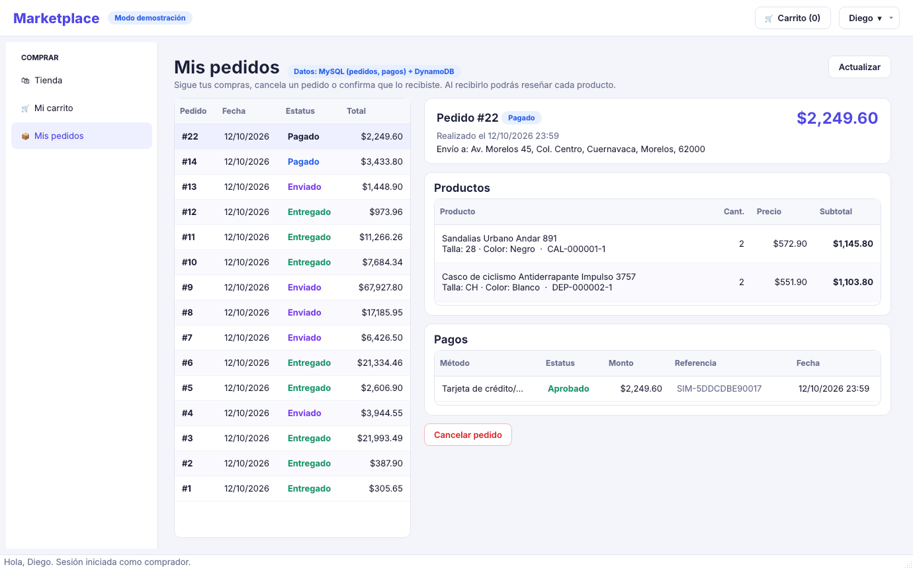
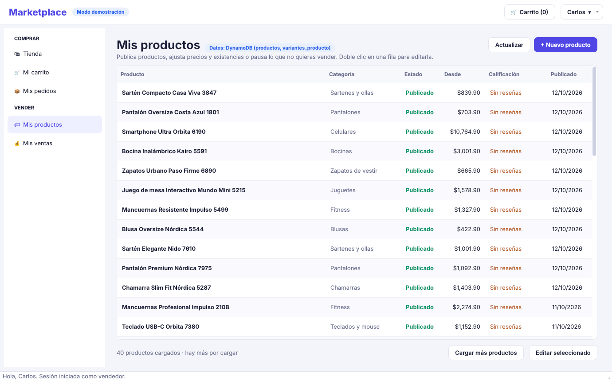
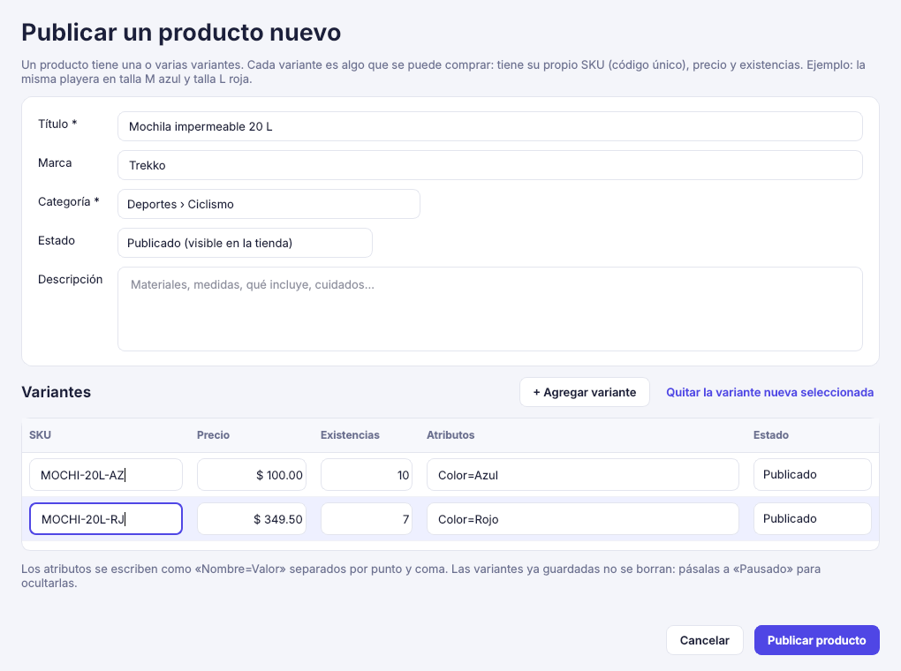
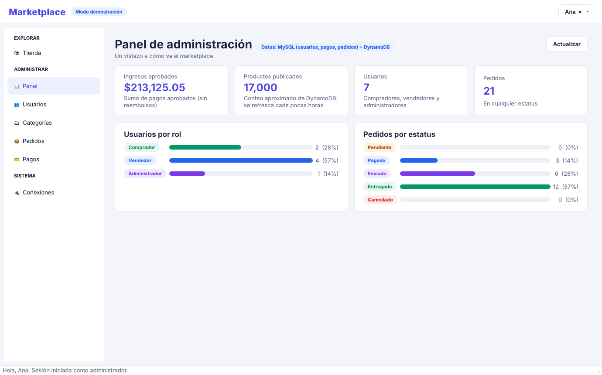
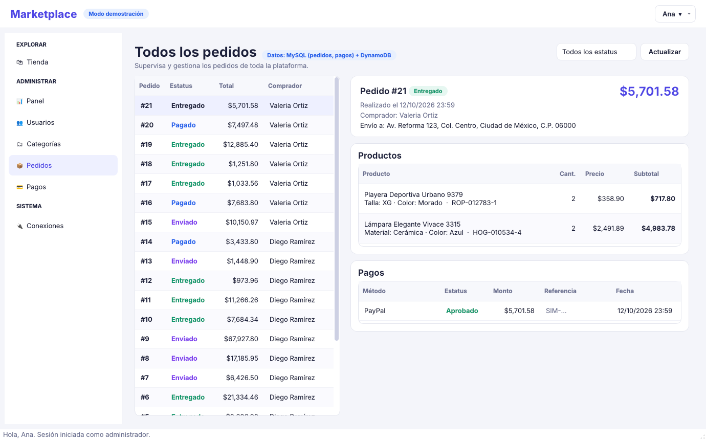
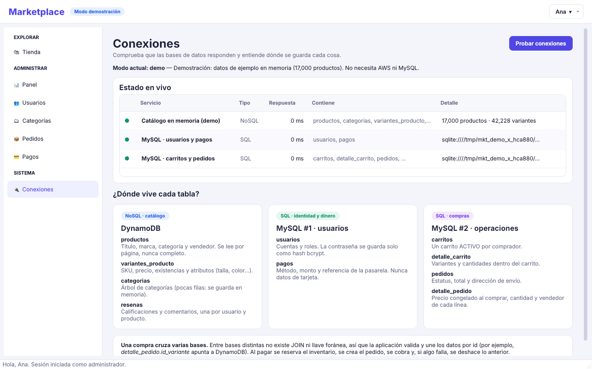

# Marketplace — interfaz gráfica en Python

Aplicación de escritorio (**PySide6 / Qt 6**) para un marketplace con **17,000+ productos**, pensada para ser
cómoda y didáctica: se entiende sola, explica los errores en español y nunca se queda «congelada».

Se conecta a tus **4 tablas de DynamoDB** (`productos`, `categorias`, `resenas`, `variantes_producto`) y a tus
**2 bases MySQL** (`usuarios` + `pagos` · `carritos` + `detalle_carrito` + `pedidos` + `detalle_pedido`), o bien —
cuando lo tengamos— **a tu backend Python por HTTP**. Los 3 modos se cambian desde la propia pantalla de inicio.

| Modo | Para qué sirve | Qué necesita |
|---|---|---|
| **Demostración** (por defecto) | Conocer la aplicación ya: 17,000 productos de ejemplo en tu computadora | Nada (ni AWS ni MySQL) |
| **Directo** | Desarrollo: la app habla con DynamoDB y los 2 MySQL | Credenciales en `.env` |
| **API** | Producción: la app habla con *tu backend* | Backend que cumpla [`docs/contrato_api.md`](docs/contrato_api.md) |




---

## 1. Inicio rápido (2 minutos, sin AWS ni MySQL)

```bash
python -m venv .venv
source .venv/bin/activate            # Windows: .venv\Scripts\activate
pip install -r requirements.txt
python main.py
```

Pulsa **Comprador**, **Vendedor** o **Administrador** en el login para entrar con una cuenta de ejemplo
(o escribe los datos de la tabla siguiente). Requiere Python 3.11 o superior (probado en 3.13).

| Rol | Correo | Contraseña |
|---|---|---|
| Administrador | `admin@demo.com` | `Admin1234` |
| Vendedor | `vendedor1@demo.com` … `vendedor4@demo.com` | `Vende1234` |
| Comprador | `comprador@demo.com`, `comprador2@demo.com` | `Compra1234` |

> ⚠ Son cuentas de demostración. Si las siembras en una base real, **bórralas o cambia sus contraseñas** antes de publicar.

Opciones de la línea de comandos: `--modo demo|directo|api`, `--env ruta/.env`, `--productos 20000` (solo demo), `--verbose`.

## 2. Qué puede hacer cada rol

| Rol | Pantallas |
|---|---|
| **Comprador** | **Tienda** (cuadrícula con desplazamiento infinito, búsqueda, árbol de categorías) · detalle de producto con variantes (talla/color…) y reseñas · **Carrito** · **Compra** (dirección + método de pago) · **Mis pedidos** (seguimiento, cancelar, «Marcar como entregado», reseñar) |
| **Vendedor** | Todo lo del comprador + **Mis productos** (publicar/editar con variantes, SKU, precio, existencias, activar/pausar) + **Mis ventas** (marcar como enviado) |
| **Administrador** | **Panel** con indicadores · **Usuarios** (cambiar rol, suspender/reactivar) · **Categorías** (árbol, crear/editar/mover) · **Pedidos** (todos, cambiar estatus) · **Pagos** · **Conexiones** (estado de cada base de datos) |

El menú lateral solo muestra lo que tu rol puede usar; el servidor/gateway vuelve a comprobar los permisos (la interfaz
nunca es la única barrera).










### Por qué se siente fluida con 17,000+ productos

* **La cuadrícula está virtualizada** (`QListView` + delegado): se dibujan solo las tarjetas visibles, da igual si hay 24 o 24,000 cargadas.
* **Carga incremental**: al acercarte al final se pide la siguiente página (24 productos) con un cursor opaco; nunca se descarga el catálogo completo.
* **Ninguna consulta bloquea la ventana**: todo corre en un pool de hilos (`app/ui/trabajos.py`) y los resultados vuelven al hilo de la interfaz. Si cierras una pantalla antes de que llegue la respuesta, se descarta sin errores. Un contador de generación evita que una búsqueda lenta pise a una más nueva.
* **La búsqueda se lanza con Enter o con el botón «Buscar»** (no una consulta por cada tecla), y se puede cambiar entre «por prefijo» (rápida) y «en cualquier parte».
* **Errores amables**: «No se pudo conectar con el backend…» en lugar de una traza; si falla una base al arrancar, hay una pantalla con **Reintentar** y **Cambiar conexión**.

---

## 3. Arquitectura

```
┌────────────────────────────  app/ui  (PySide6)  ────────────────────────────┐
│  login · tienda · producto · carrito · pedidos · vendedor · admin · ajustes │
└───────────────────────────────┬──────────────────────────────────────────────┘
                                │  una sola interfaz:  Gateway (app/gateways/base.py)
        ┌───────────────────────┼─────────────────────────┐
        ▼                       ▼                         ▼
 GatewayDirecto          GatewayDirecto             GatewayApi
 (modo demo)             (modo directo)             (modo api)
 catálogo en memoria     boto3 → DynamoDB           requests → tu backend Python
 + SQLite temporal       SQLAlchemy → 2× MySQL      (docs/contrato_api.md)
```

* **`app/gateways/base.py`** define el contrato `Gateway`: 28 operaciones («listar productos», «checkout», «cambiar estatus»…).
  La interfaz **solo** conoce esta clase → cambiar de modo no cambia ni una línea de pantalla.
* **`GatewayDirecto`** contiene *todas las reglas de negocio* (validaciones, permisos, checkout, estados del pedido). Se apoya en:
  * `app/catalogo/` — `CatalogoDynamo` (boto3) y `CatalogoMemoria` (demo), misma interfaz `CatalogoBase`.
  * `app/relacional/` — `AlmacenSql` (SQLAlchemy 2 *Core*) sobre **dos motores**: `usuarios`+`pagos` y `operaciones`. En demo, ambos son un SQLite en memoria.
* **`GatewayApi`** traduce cada operación a una llamada REST y las respuestas a los mismos modelos (`app/models.py`).
* Cuando construyamos el backend, **puede reutilizar `GatewayDirecto`, `app/catalogo` y `app/relacional` tal cual** envueltos en FastAPI:
  la lógica ya está escrita y probada, y la app de escritorio pasa a modo `api` sin cambios.

### Estructura de carpetas

```
main.py                       punto de entrada
app/
  config.py                   configuración (CLI > ajustes de la app > .env > valores por defecto)
  models.py  errors.py        modelos de dominio y errores controlados
  serialization.py            modelos ⇄ JSON (la usa el modo API y el backend)
  catalogo/                   DynamoDB (esquema.py = única fuente de verdad de las 4 tablas), memoria
  relacional/                 esquema.py (las 6 tablas MySQL), motores.py, almacen.py (consultas)
  gateways/                   base · directo · api · fabrica
  pagos.py                    pasarela de pago SIMULADA (interfaz para conectar una real)
  demo_data.py                generador determinista de 17,000 productos y cuentas de ejemplo
  ui/                         pantallas, tema (theme.py) y widgets reutilizables
scripts/                      crear tablas, sembrar datos, probar conexiones, exportar DDL
sql/                          DDL de MySQL ya generado (para revisarlo o ejecutarlo a mano)
tests/                        pruebas de contrato, unitarias y de interfaz
docs/contrato_api.md          el contrato REST del futuro backend
```

---

## 4. Conectar con tus bases de datos reales (modo «directo»)

> ⚠ **Solo desarrollo.** En este modo la computadora del usuario tiene las credenciales de las bases de datos.
> Para producción usa el modo **API** (sección 6) y deja las credenciales únicamente en el servidor.

### 4.1 Configuración

```bash
cp .env.example .env     # y edítalo: región AWS, host/usuario/contraseña de los 2 MySQL…
```

Credenciales de AWS: las normales (`AWS_PROFILE`, o `AWS_ACCESS_KEY_ID`/`AWS_SECRET_ACCESS_KEY`, o un rol de IAM).
Todas las variables están comentadas en [`.env.example`](.env.example). Resumen:

| Variable | Qué es |
|---|---|
| `MKT_MODO` | `demo` · `directo` · `api` |
| `AWS_REGION`, `MKT_DYNAMO_ENDPOINT`, `MKT_DYNAMO_PREFIJO` | región, endpoint (DynamoDB Local) y prefijo opcional de las tablas |
| `MKT_USUARIOS_HOST/PORT/DB/USER/PASSWORD/SSL_CA` o `MKT_USUARIOS_URL` | **MySQL #1** (`usuarios`, `pagos`) |
| `MKT_OPS_HOST/PORT/DB/USER/PASSWORD/SSL_CA` o `MKT_OPS_URL` | **MySQL #2** (`carritos`, `detalle_carrito`, `pedidos`, `detalle_pedido`) |
| `MKT_API_URL`, `MKT_API_TIMEOUT` | dirección del backend (modo API) |
| `MKT_BCRYPT_ROUNDS`, `MKT_TAMANO_PAGINA`, `MKT_DEMO_PRODUCTOS` | ajustes finos |

La prioridad es: **línea de comandos > lo guardado en «Conexión» dentro de la app > `.env` > valores por defecto**.
Las contraseñas **nunca** se guardan desde la interfaz.

### 4.2 Crear las tablas y cargar datos de ejemplo

```bash
python scripts/crear_tablas_dynamodb.py        # 4 tablas + índices   (--solo-mostrar para verlas sin tocar AWS)
python scripts/crear_esquema_mysql.py --crear-bases   # CREATE DATABASE (si no existen) + las 6 tablas
python scripts/sembrar_datos.py                # 17,000 productos, cuentas, algunos pedidos/pagos/reseñas
python scripts/probar_conexiones.py            # ¿responden las 3 bases?
python main.py --modo directo
```

Todos los scripts son **idempotentes** (puedes repetirlos). Si prefieres revisar el SQL antes: `python scripts/exportar_ddl.py`
genera `sql/mysql_usuarios_pagos.sql` y `sql/mysql_operaciones.sql` (ya incluidos).
Para probar sin gastar en AWS usa **DynamoDB Local** (`MKT_DYNAMO_ENDPOINT=http://localhost:8000`) y un MySQL/MariaDB local.

Permisos IAM mínimos para la app: `dynamodb:GetItem, BatchGetItem, Query, Scan, PutItem, UpdateItem, DeleteItem, DescribeTable`
sobre las 4 tablas y sus índices (`…/table/productos/index/*`) — `TransactWriteItems` se autoriza con los permisos de cada operación que contiene (`PutItem`, `UpdateItem`, `ConditionCheck`).
`CreateTable`/`ListTables` solo para el script de creación y `BatchWriteItem` solo para el de siembra.
En MySQL: un usuario con `SELECT, INSERT, UPDATE` (y `DELETE` en `detalle_carrito`) sobre cada base; DDL solo para quien cree el esquema.

---

## 5. Cómo está diseñado el acceso a datos

### 5.1 DynamoDB — patrones de acceso (sin `Scan` completo)

| Qué hace la pantalla | Operación | Índice |
|---|---|---|
| Ver un producto | `GetItem` | tabla `productos` |
| Productos de una categoría (y sus subcategorías) | `Query` (una por categoría), más nuevos primero | `gsi_categoria` (`id_categoria`, `fecha_creacion`) |
| Buscar por **prefijo** del título | `Query` con `begins_with` | `gsi_busqueda` (`bucket_busqueda`, `titulo_lower`) |
| Buscar texto **dentro de una categoría** | `Query` + filtro `contains` (siempre «en cualquier parte del nombre») | `gsi_categoria` |
| Buscar «en cualquier parte» (opcional) | `Scan` **acotado** con filtro `contains` y tope de lectura | tabla |
| Catálogo sin filtros | `Scan` por páginas de 24 con `Limit` (una página por llamada) | tabla |
| «Mis productos» del vendedor | `Query` | `gsi_vendedor` (`id_vendedor`, `fecha_creacion`) |
| Variantes de un producto | `Query` | `gsi_producto` (`id_producto`) |
| Variantes del carrito / de un pedido | `BatchGetItem` | tabla `variantes_producto` |
| Reseñas de un producto | `Query`, más recientes primero | `lsi_fecha` (`id_producto`, `fecha_resena`) |
| ¿Ya reseñó este usuario? / crear reseña | `GetItem` / `TransactWriteItems` | `resenas` (PK `id_producto` + SK `id_usuario`) |
| Reservar existencias en el checkout | `TransactWriteItems` con `cantidad_stock >= n` (todo o nada) | `variantes_producto` |

Los cursores de paginación son el `LastEvaluatedKey` codificado, así que el cliente no necesita saber nada del esquema.
Los clientes de boto3 son uno por hilo (no son *thread-safe*).

### 5.2 MySQL

* **SQLAlchemy 2 Core** (sin ORM): SQL explícito, fácil de leer y de optimizar.
* **Paginación por llave (*keyset*)**, no `OFFSET`: igual de rápida en la página 1 que en la 10,000.
* **Actualizaciones condicionales** (`UPDATE … WHERE estatus = :anterior`): dos personas no pueden cambiar el mismo pedido a la vez.
* **Sin llaves foráneas entre bases** (MySQL no las admite entre servidores, y DynamoDB menos): `id_variante`, `id_vendedor`… se validan en la aplicación.
* Contraseñas con **bcrypt**; el login responde igual si el correo no existe (no se revelan cuentas).

### 5.3 Una compra toca 3 bases: *saga* con compensaciones

No hay transacciones entre DynamoDB y MySQL, así que el checkout hace:
**① validar → ② reservar existencias (DynamoDB, atómico) → ③ crear pedido + líneas y convertir el carrito (MySQL, transacción) → ④ cobrar y registrar el pago (MySQL #1)**.
Si un paso falla se deshacen los anteriores (se liberan las existencias, el pedido pasa a `CANCELADO`). Las pruebas cubren esos caminos
(pago rechazado, falla al crear el pedido, dos compradores peleando la última pieza).

---

## 6. Conectar con el backend (modo «API»)

1. Construye el backend siguiendo [`docs/contrato_api.md`](docs/contrato_api.md) (rutas, formas JSON, errores, permisos, checkout).
2. En la app: **Conexión → Mi backend (API)**, escribe la dirección y pulsa **Probar conexión** (llama a `GET /salud`).
   O desde la terminal: `python scripts/probar_conexiones.py --modo api` y `python main.py --modo api`.
3. Es lo único que cambia: ninguna pantalla se toca.

`tests/fake_api.py` ya implementa ese contrato (sobre `GatewayDirecto`) y es la **especificación ejecutable** que el backend debe cumplir.

---

## 7. Pruebas

```bash
pip install -r requirements-dev.txt
pytest                                   # todo (las de interfaz corren «sin pantalla»)
pytest tests/test_contrato.py            # las mismas pruebas contra: memoria · DynamoDB simulado (moto) · API falsa
pytest tests/test_ui.py                  # recorre las pantallas por rol, compra completa, búsqueda, administración
MKT_TEST_MYSQL=mysql+pymysql://root@127.0.0.1:3306 pytest tests/test_contrato.py   # además, MySQL/MariaDB de verdad
```

* Con `MKT_TEST_MYSQL` se crean y se borran las bases `mkt_test_usuarios` y `mkt_test_ops` en ese servidor: **apúntalo a uno desechable**.
* La suite de contrato se ejecuta con la misma batería sobre cada implementación: si pasa en una y falla en otra, hay una diferencia de comportamiento.
* Las pruebas con DynamoDB usan **moto** (memoria): no tocan AWS ni cuestan nada.

---

## 8. Decisiones y diferencias respecto al esquema original

Para que la lectura sea honesta, estas son las **desviaciones o supuestos** que conviene que revises:

1. **MySQL en las dos bases.** La captura del esquema agrupaba `usuarios` y `pagos` bajo Oracle; seguí tu indicación escrita (2 bases MySQL).
   Las tablas se generan con SQLAlchemy y funcionan en MySQL 8 (recomendado) y MariaDB 10.11 (donde se probó con las pruebas de contrato).
2. **Datos desnormalizados en `productos`** (`precio_desde`, `suma_calificacion`, `num_resenas`, `titulo_lower`, `bucket_busqueda`):
   DynamoDB no tiene `JOIN` ni agregaciones, y pintar 24 tarjetas con precio y estrellas no puede costar 24 consultas extra.
   Se mantienen al crear/editar variantes y al crear reseñas (en la misma transacción que la reseña).
3. **Clave de `resenas`** = `id_producto` (partición) + `id_usuario` (orden): garantiza *una reseña por usuario y producto* sin consultas adicionales; el orden por fecha lo da un LSI.
4. **SKU único** en todo el catálogo mediante ítems «candado» `SKU#<sku>` con `attribute_not_exists` (DynamoDB no tiene índices únicos).
5. **Categorías**: el filtro por una categoría padre incluye a sus descendientes; el árbol se carga una vez y se cachea en memoria (son pocas y casi no cambian).
6. **Búsqueda por prefijo** del título (rápida, escalable). La búsqueda «contiene» existe pero es un `Scan` acotado, útil en un catálogo de este tamaño pero **no** para
   cientos de miles de productos. Si el catálogo crece o necesitas relevancia, tolerancia a faltas de ortografía, sinónimos, etc., el paso natural es
   **Amazon OpenSearch** alimentado por DynamoDB Streams; el parámetro `q` del contrato no cambia.
7. **Un estatus por pedido** (así es el esquema). Un pedido con productos de varios vendedores lo marca como enviado el **administrador**; un vendedor
   solo puede hacerlo si es el único vendedor del pedido, y la app se lo explica con un mensaje claro. Si quieres que cada vendedor envíe lo suyo,
   el cambio correcto es añadir `estatus` a `detalle_pedido`.
8. **Pagos simulados.** `app/pagos.py` define la interfaz `Pasarela` y una implementación de mentira. **La aplicación nunca captura números de tarjeta** (PCI-DSS):
   el backend real debe cobrar con Stripe / Conekta / Mercado Pago usando su página o token.
9. **Reseñas solo de compras entregadas** (pedido `ENTREGADO`), una por usuario, no del propio producto. Es una regla de negocio fácil de cambiar en `GatewayDirecto.elegibilidad_resena`.
10. **Catálogo sin filtros ordenado por clave**, no por fecha (es un `Scan` paginado). Para «novedades primero» sin filtros, añade un GSI con una partición fija
    (o por mes) y `fecha_creacion` como orden.

## 9. Seguridad (lista corta)

* **Modo directo = solo desarrollo.** El backend existe para que las credenciales de AWS/MySQL no salgan del servidor.
* `.env` no se versiona (añádelo a `.gitignore`). Usa **roles de IAM** o perfiles temporales, nunca llaves de administrador.
* Usuarios de base de datos con **mínimo privilegio** (sección 4.2) y **TLS** a MySQL (`MKT_*_SSL_CA`).
* Cambia o elimina las cuentas de demostración en cualquier base que no sea de pruebas.
* Contraseñas: bcrypt (costo 12 por defecto), mínimo 8 caracteres con letras y números, máximo 72 bytes (límite de bcrypt).
* En el backend: HTTPS obligatorio, *rate limiting* en login/registro, tokens con vencimiento, y validar el rol **en el servidor** en cada ruta.

## 10. Solución de problemas

| Síntoma | Qué revisar |
|---|---|
| Pantalla «No se pudo conectar» al abrir en modo directo | `python scripts/probar_conexiones.py` indica cuál de las 3 bases falla; revisa `.env`, security groups/VPN y la región |
| `Unknown database` | Crea las bases (`--crear-bases`) o con `CREATE DATABASE … CHARACTER SET utf8mb4` |
| `cryptography package is required` (MySQL 8) | `pip install cryptography` (ya está en `requirements.txt`) |
| `ResourceNotFoundException` de DynamoDB | Ejecuta `crear_tablas_dynamodb.py` (¿mismo `MKT_DYNAMO_PREFIJO` y región?) |
| Quiero volver al modo de ejemplo | Pantalla de login → **Conexión** → *Demostración*; o `python main.py --modo demo` |
| La ventana sale en blanco o sin fuentes en Linux | Instala `libxcb-cursor0` y fuentes del sistema; en servidores sin pantalla usa `QT_QPA_PLATFORM=offscreen` (solo pruebas) |
| Los ajustes guardados en la app mandan sobre el `.env` | Es la prioridad prevista; cámbialos en **Conexión**, o usa `--modo` / `--env` para forzar |
